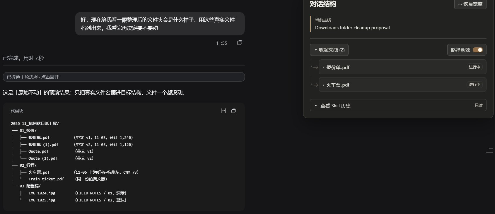

# Conversation Structure for DeepSeek Harness

**Ask about one sentence in a side conversation, then return to the exact passage with your conclusion.**

[中文](README.zh-CN.md) · [Install the plugin](docs/INSTALL.md) · [What has been tested](docs/STATUS.md)



*November 16, local development build. The main chat previews the folder layout. Two questions from the same answer sit side by side in the conversation tree.*

### Try a side question

> Put the exhibition quotes in one folder and the train ticket in another.

<details><summary><b>↳ Quotes · Did the supplier change the price?</b></summary>

Yes. Both documents cover 40 booklets. Revision 2 drops the unit price from CNY 28 to 25, bringing the total down from CNY 1,240 to 1,120.

</details>

<details><summary><b>↳ Train ticket · How can I find it if I forget the date?</b></summary>

Put the destination first. Searching for Hangzhou will find `Hangzhou-East_2026-11-06_train_73-CNY.pdf`.

</details>

This expandable example uses a fixed answer. In DSH, select the passage and click **深入追问** to open a child conversation with your model. **返回原文** returns you to the source, where you can keep a one-line conclusion. Use the built-in quote action when you want the follow-up in the same conversation.

[More real UI screenshots](docs/SCREENSHOTS.md) · [Offline tree demo](demo/structure-flow-preview.html) (download the HTML and open it in a browser)

## Use with DSH

With Node.js 22.19+ and the DSH CLI available, run from the extracted repository:

```sh
npm run build:client
dsh plugin --profile desktop add ./dsh-plugin
```

Restart DSH. Look for **展开结构图** at the top right and **对话结构** below the composer. Use `--profile web` instead if that is the profile you actually use.

Desktop users without the `dsh` command: see the [PowerShell installation route](docs/INSTALL.md). Installing the optional Skill alone does **not** install the UI.

## Included in this preview

| Feature | Behavior |
| --- | --- |
| Anchored follow-ups | Maps supported visible selections to versioned source text before branching |
| Parallel and nested branches | Separate child Sessions, collapsible cards, pause/resume and manual conclusions |
| Return to reading | Restores the source message's relative viewport position when available |
| Topic branches | No text selection required; starts with the main topic name and your question |
| Active-path navigation | Muted green flow lines, directional arrows, current-location badge and motion toggle |
| Keyboard submission | Enter submits; IME composition does not submit |
| Optional local Skill | Records a separate state tree; snapshots can be imported as read-only overviews |

## Know the boundaries

- The baseline UI was exercised on **DSH 0.2.1-rc.3**. Newer DSH versions may change the integration points.
- Complex Markdown selections can be rejected when source mapping is uncertain. Do not use a rendered offset as a source offset.
- The latest topic, import, keyboard and motion additions have not received a complete DSH GUI acceptance pass. [Evidence and scope](docs/STATUS.md).
- Plugin branch associations use the current browser profile's `localStorage`; clearing it can remove the tree even if DSH Sessions remain. No cross-device sync yet.
- Ordinary composer messages are not automatically classified into branches. Use the plugin's branch controls.
- The Skill and UI do not share a live state store. Historical imports are read-only and do not become navigable DSH child Sessions.
- Anchored branches use DSH's earlier completed turns plus the source-answer prefix. New topic branches use a blank Session with the main topic name and question. Conclusions are entered manually.
- The optional compact-context experiment stays **off by default**. One A/B pair is not a cost-saving guarantee.

Model requests go through your configured DSH provider and its normal usage accounting. The plugin adds no separate analytics service.

## Development and feedback

```sh
npm run build:client
npm test
```

No extra npm dependencies are needed for the local state engine or demos. `dsh-plugin/client.template.js` is the UI source; `client.js` is its generated bundle.

Useful feedback: a concrete conversation where branching helped—or where you lost your place. Include DSH version and reproduction steps; omit credentials and private conversations. See [Contributing](CONTRIBUTING.md).

If this solves a problem you have, a star helps others discover it. Bug reports and real usage examples help make it better.

## License

MIT. This is an independent community project, not an official DeepSeek product.

## Test evidence

- [Core flow acceptance, 2026-10-31 (Chinese, redacted)](docs/validation/dsh-mvp-final-acceptance-result-2026-10-31.md): steps, navigation, persistence, rejection cases and usage.
- [Context A/B experiment, 2026-11-01 (Chinese, redacted)](docs/validation/token-context-ab-result-2026-11-01.md): one matched pair, including limitations.
- [Release preparation checks](docs/BUILD-REPORT.md). Historical acceptance does not certify all current additions.
