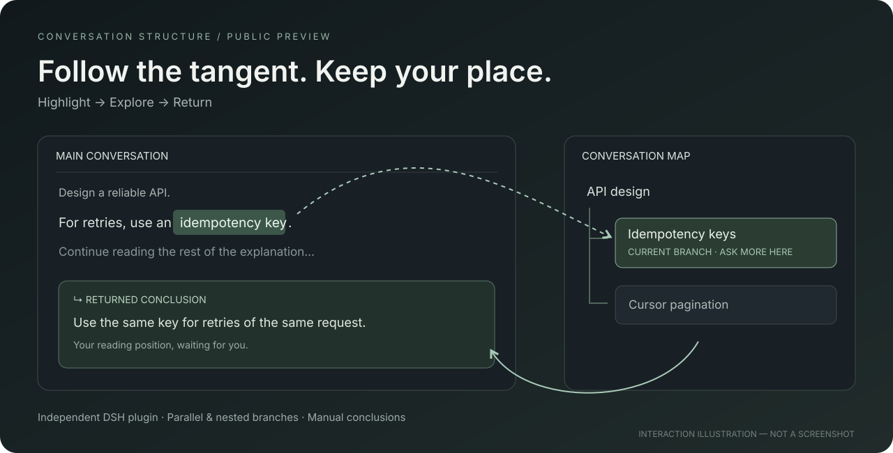
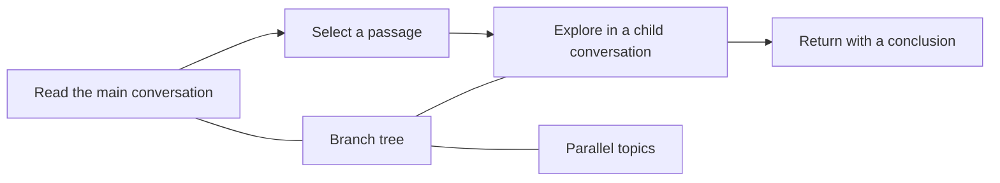

# Conversation Structure

### Follow the tangent. Keep your place.

**Highlight a sentence. Explore it in a branch. Bring a conclusion back to where you were reading.**

A conversation UI plugin for **DeepSeek Harness (DSH)**, with anchored follow-ups, parallel topics, and a navigable branch tree.

[中文](README.zh-CN.md) · [Installation](docs/INSTALL.md) · [What is verified](docs/STATUS.md) · [Release notes](CHANGELOG.md)



*Interaction illustration, not a screenshot. This is an experimental preview; it requires DSH for real AI conversations.*

## The moment this is for

You are reading an explanation. One sentence deserves a deeper question. A few follow-ups later, the original thread is buried.

Conversation Structure gives that detour its own place:

1. **Highlight** a supported passage in a completed answer.
2. **Branch** into a real child Session and keep asking.
3. **Return** to the source, optionally leaving a short conclusion.
4. **Navigate** parallel and nested topics from a collapsible tree.

No passage to highlight? Use **New topic branch / 新话题支线** to open a related topic under the same main conversation.

## At a glance



Workflow illustration, not a recording. A real DSH clip is still pending; see the [capture checklist](docs/RECORDING.md).

## Try the interaction before installing

Download this repository with **Code → Download ZIP**, extract it, and open `demo/structure-flow-preview.html` in a browser. It is a local visual demo with example data: no account, model request, or DSH connection.

For a local state-engine demo with simulated answers:

```sh
node demo/server.mjs
```

Open `http://127.0.0.1:4173`. This demo does not call an AI model.

## Use with DSH

With Node.js 22.19+ and the DSH CLI available, run from the extracted repository:

```sh
npm run build:client
dsh plugin --profile desktop add ./dsh-plugin
```

Restart DSH. Look for **展开结构图** at the top right and **对话结构** below the composer. Use `--profile web` instead if that is the profile you actually use.

Desktop users without the `dsh` command: see the [PowerShell installation route](docs/INSTALL.md). Installing the optional Skill alone does **not** install the UI.

## Included in this preview

| Feature | Behavior |
| --- | --- |
| Anchored follow-ups | Maps supported visible selections to versioned source text before branching |
| Parallel and nested branches | Separate child Sessions, collapsible cards, pause/resume and manual conclusions |
| Return to reading | Restores the source message's relative viewport position when available |
| Topic branches | No text selection required; starts with the main topic name and your question |
| Active-path navigation | Muted green flow lines, directional arrows, current-location badge and motion toggle |
| Keyboard submission | Enter submits; IME composition does not submit |
| Optional local Skill | Records a separate state tree; snapshots can be imported as read-only overviews |

## Know the boundaries

- The baseline UI was exercised on **DSH 0.2.1-rc.3**. Newer DSH versions may change the integration points.
- Complex Markdown selections can be rejected when source mapping is uncertain. Do not use a rendered offset as a source offset.
- The latest topic, import, keyboard and motion additions have not received a complete DSH GUI acceptance pass. [Evidence and scope](docs/STATUS.md).
- Plugin branch associations use the current browser profile's `localStorage`; clearing it can remove the tree even if DSH Sessions remain. No cross-device sync yet.
- Ordinary composer messages are not automatically classified into branches. Use the plugin's branch controls.
- The Skill and UI do not share a live state store. Historical imports are read-only and do not become navigable DSH child Sessions.
- Anchored branches use DSH's earlier completed turns plus the source-answer prefix. New topic branches use a blank Session with the main topic name and question. Conclusions are entered manually.
- The optional compact-context experiment stays **off by default**. One A/B pair is not a cost-saving guarantee.

Model requests go through your configured DSH provider and its normal usage accounting. The plugin adds no separate analytics service.

## Development and feedback

```sh
npm run build:client
npm test
```

No extra npm dependencies are needed for the local state engine or demos. `dsh-plugin/client.template.js` is the UI source; `client.js` is its generated bundle.

Useful feedback: a concrete conversation where branching helped—or where you lost your place. Include DSH version and reproduction steps; omit credentials and private conversations. See [Contributing](CONTRIBUTING.md).

If this solves a problem you have, a star helps others discover it. Bug reports and real usage examples help make it better.

## License

MIT. This is an independent community project, not an official DeepSeek product.

## Test evidence

- [Core flow acceptance, 2026-10-31 (Chinese, redacted)](docs/validation/dsh-mvp-final-acceptance-result-2026-10-31.md): steps, navigation, persistence, rejection cases and usage.
- [Context A/B experiment, 2026-11-01 (Chinese, redacted)](docs/validation/token-context-ab-result-2026-11-01.md): one matched pair, including limitations.
- [Release preparation checks](docs/BUILD-REPORT.md). Historical acceptance does not certify all current additions.
