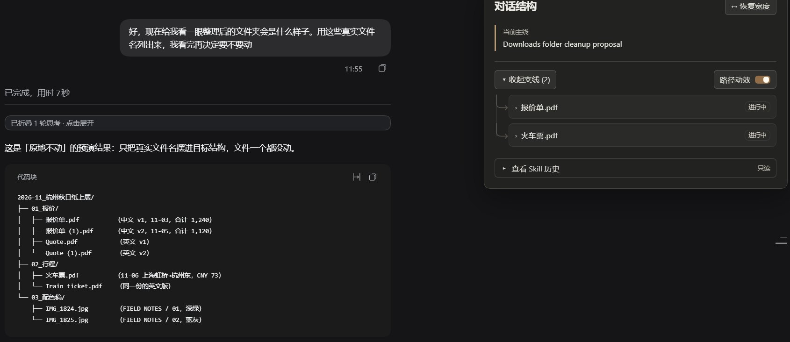

# Conversation Structure · DSH 对话支线插件

**读到一句话，想多问几轮？选中它单独聊，聊完带一句结论回到原文。**

[English](README.md) · [安装插件](docs/INSTALL.md) · [实测记录](docs/STATUS.md)



*11 月 16 日本地开发版实拍。主线继续预览整理后的文件夹，右侧保留从同一段回答岔出去的两个问题。*

### 点开你想追问的文件

> 展会报价放进「报价」，火车票放进「行程」。

<details><summary><b>↳ 报价单 · 供应商后来改过价格吗？</b></summary>

改过。两版都是 40 本手册，第二版每本从 28 元降到 25 元，总价从 1,240 元降到 1,120 元。

</details>

<details><summary><b>↳ 火车票 · 月底只记得去了杭州，怎么找？</b></summary>

把目的地放在文件名最前面。搜「杭州」，就能找到 `杭州东_2026-11-06_高铁票_73元.pdf`。

</details>

上面是可以收起的固定示例。在 DSH 中，选中原文点 **深入追问**，就能在独立会话里继续问模型；点 **返回原文**，可以把自己写的一句结论留在出处。想在当前会话接着聊时，用 DSH 自带的「引用文本」即可。

[更多实测画面](docs/SCREENSHOTS.md) · [离线结构树演示](demo/structure-flow-preview.html)（下载 HTML 后用浏览器打开）

## 安装到 DSH

准备 Node.js 22.19+；在项目根目录执行：

```sh
npm run build:client
dsh plugin --profile desktop add ./dsh-plugin
```

退出并重新打开 DSH。右上角应出现 **展开结构图**，输入框下方应出现 **对话结构**。使用 Web profile 的用户将 `desktop` 改为 `web`。

桌面版没有 `dsh` 命令时，使用[安装说明中的 PowerShell 方法](docs/INSTALL.md)。**只调用 `/conversation-structure` Skill 不会安装界面插件。**

## 当前边界

- 历史核心流程已在 DSH 0.2.1-rc.3 实测；新话题、导入、回车和最新动效尚未完成新版 GUI 集中验收。
- 复杂 Markdown 选区可能被明确拒绝；支持范围内才会创建精确锚点。
- 分支关联保存在当前浏览器 profile 的 localStorage，暂不跨设备同步。清除此存储会丢失结构关联。
- 普通聊天框的问题不会自动分类；新支线需要通过插件入口创建。
- Skill 和插件尚未实时双向同步。旧 Skill 状态可以导入只读总览，不能直接跳转成真实 DSH 子会话。
- 片段支线继承此前完整轮次及来源回答前缀；新话题只带主线名称和本次问题，需要的条件请写在问题里。
- 结论目前手动填写。精简上下文实验默认关闭，一组 A/B 不能证明普遍节省费用。

真实模型调用仍由 DSH 和你配置的模型服务处理，按原有方式计量。详见[验证状态](docs/STATUS.md)。

## 帮它变得更好

欢迎提交具体使用场景：在哪一次追问中，它帮你保住了主线？又在哪一步让你迷路了？反馈附上 DSH 版本和复现步骤即可，别上传私人会话或凭据。

觉得这个方向有用，可以点一个 Star，让更多有同样困扰的人找到它。

MIT 许可证。独立社区项目，非 DeepSeek 官方产品。

## 实测证据

- [2026-10-31 核心流程验收（公开脱敏版）](docs/validation/dsh-mvp-final-acceptance-result-2026-10-31.md)：逐步操作、嵌套/平行、返回位置、持久化、拒绝边界和 Token 记录。
- [2026-11-01 上下文 A/B 实测（公开脱敏版）](docs/validation/token-context-ab-result-2026-11-01.md)：同锚点、同问题的一组对照，含局限。
- [本次发布的本地检查](docs/BUILD-REPORT.md)。历史验收不等于最新版本完整验收。
