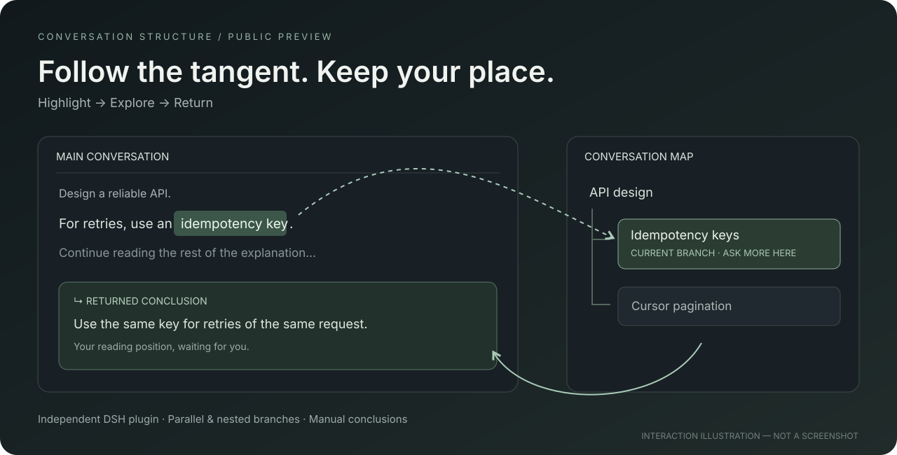

# Conversation Structure

### 对话可以岔开，思路不必走丢。

**选中一句话，单独追问；聊透之后，带着结论回到原处。**

这是一个用于 **DeepSeek Harness（DSH）** 的对话界面插件，支持片段追问、平行话题和结构树导航。

[English](README.md) · [安装](docs/INSTALL.md) · [验证范围](docs/STATUS.md)



*上图是交互示意，不是真实应用截图。当前是实验性公开预览版。*

## 读到一半，你想问一句“为什么”

一句追问变成五轮讨论，再想回去，原来的重点已经淹没在聊天记录里。

这个插件把这次插问放进一条支线：

1. 选中已完成回答中的片段，点击 **深入追问**。
2. 在独立子会话中继续讨论，也可以再开嵌套支线。
3. 点击 **返回原文**，可带回一句手动填写的结论。
4. 从右侧结构树展开、收起和切换话题。

没有对应原文的新问题，也可以通过 **新话题支线** 挂到同一个主线下。例如，“计算方法”下并列放置矩阵迭代、数值积分和计算器使用。

## 先看看效果

通过 GitHub 的 **Code → Download ZIP** 下载并解压，直接打开 `demo/structure-flow-preview.html`。可切换示例分支、观察当前路径动效；无需账号，不产生模型请求。

需要体验本地状态管理，可运行 `node demo/server.mjs`，打开 `http://127.0.0.1:4173`。这里的回答是模拟内容。

## 安装到 DSH

准备 Node.js 22.19+；在项目根目录执行：

```sh
npm run build:client
dsh plugin --profile desktop add ./dsh-plugin
```

退出并重新打开 DSH。右上角应出现 **展开结构图**，输入框下方应出现 **对话结构**。使用 Web profile 的用户将 `desktop` 改为 `web`。

桌面版没有 `dsh` 命令时，使用[安装说明中的 PowerShell 方法](docs/INSTALL.md)。**只调用 `/conversation-structure` Skill 不会安装界面插件。**

## 当前边界

- 历史核心流程已在 DSH 0.2.1-rc.3 实测；新话题、导入、回车和最新动效尚未完成新版 GUI 集中验收。
- 复杂 Markdown 选区可能被明确拒绝；支持范围内才会创建精确锚点。
- 分支关联保存在当前浏览器 profile 的 localStorage，暂不跨设备同步。清除此存储会丢失结构关联。
- 普通聊天框的问题不会自动分类；新支线需要通过插件入口创建。
- Skill 和插件尚未实时双向同步。旧 Skill 状态可以导入只读总览，不能直接跳转成真实 DSH 子会话。
- 片段支线继承此前完整轮次及来源回答前缀；新话题只带主线名称和本次问题，需要的条件请写在问题里。
- 结论目前手动填写。精简上下文实验默认关闭，一组 A/B 不能证明普遍节省费用。

真实模型调用仍由 DSH 和你配置的模型服务处理，按原有方式计量。详见[验证状态](docs/STATUS.md)。

## 帮它变得更好

欢迎提交具体使用场景：在哪一次追问中，它帮你保住了主线？又在哪一步让你迷路了？反馈附上 DSH 版本和复现步骤即可，别上传私人会话或凭据。

觉得这个方向有用，可以点一个 Star，让更多有同样困扰的人找到它。

MIT 许可证。独立社区项目，非 DeepSeek 官方产品。
