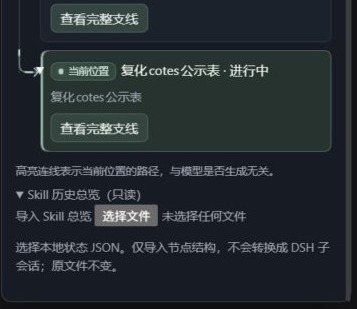

# Conversation Structure in DSH Desktop

Cropped desktop captures from November 10, 2026. The conversation is about numerical integration and calculator settings.

**Two parallel topics.** The current-location marker is on the Cotes branch.

**Switching location.** In this capture the marker is on the angle-settings branch.

**History import.** The expanded panel accepts a local Skill snapshot for read-only navigation of its outline.

